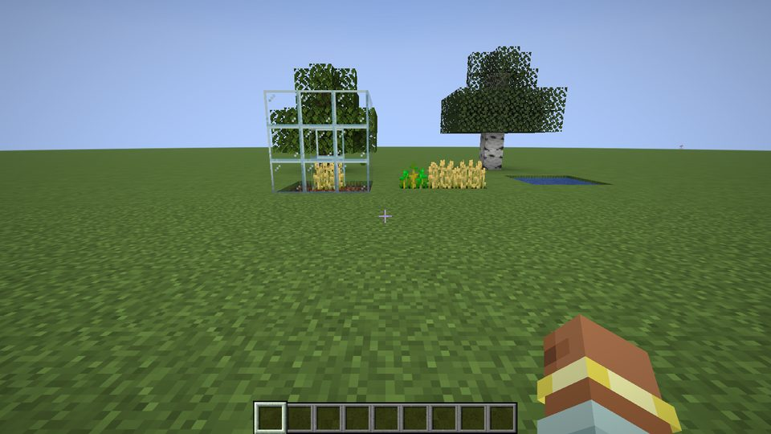
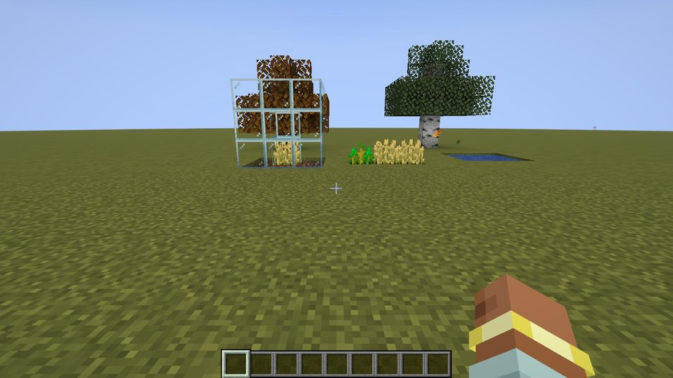
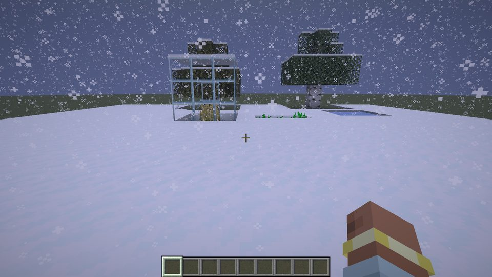
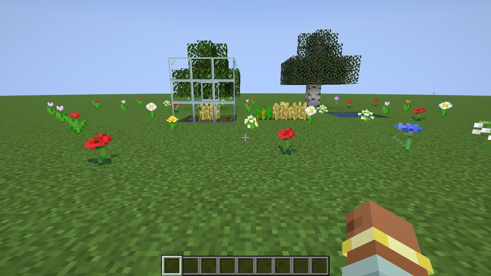

# Turning Seasons

Spring, summer, autumn and winter for Minecraft 26.3 (Fabric). A standalone mod that plays well
with Village Friends and Not-So-Vanilla Mobs but needs neither.

- **A calendar.** Each season lasts 30 Minecraft days by default (a year is 120 days); change it
  per world with `/season length <days>`. The server keeps the calendar and syncs it to everyone.
  Sleeping through the night moves it forward too.
- **Looks.** Grass and leaves slowly change colour through the year: fresh green in spring,
  vanilla in summer, gold and orange in autumn, dull and brown in winter. In autumn red, orange and
  yellow leaves drift down from the trees. In winter temperate biomes (plains, forests, taiga,
  swamps, rivers...) get snowfall: snow settles on the ground and ponds and rivers freeze over.
  In spring it all melts and wild flowers pop up on open grass.
- **Farming.** Crops grow faster in spring (x1.25) and summer (x1.5), normally in autumn, and
  slowly (x0.5) in winter under a roof. Crops out in the open **stop growing in winter**, unless
  there's glass overhead: build a greenhouse. Works on every block in `#minecraft:crops` and
  saplings, so other mods' crops count too.
- **Weather.** Rain is more common in spring and autumn, rarer in summer.
- **Animals.** Animals are ready to breed again twice as fast in spring and take twice as long in
  winter.
- **Mobs.** Spawns lean seasonal: more farm animals in spring, more wolves and foxes in winter, a
  few more skeletons and zombies in autumn. With Not-So-Vanilla Mobs installed, Frostbitten and
  Penguins favour winter, Glowmoths summer (none in winter) and Scarecrows autumn. All of this is
  data-driven (`data/<ns>/seasonal_spawns/*.json`).

| Summer | Autumn | Winter | Spring |
|---|---|---|---|
|  |  |  |  |

The same test farm through the year: an open wheat row, a glass greenhouse, a pond and two trees
(birch leaves keep their own colour in vanilla, so only the oak turns).

## Playing

| | |
|---|---|
| `/season` | tells you the season, the day and how long until the next season |
| `/season set <spring\|summer\|autumn\|winter> [day]` | jump forward to that season (operators) |
| `/season advance <days>` | move the calendar forward (operators) |
| `/season length` | how many days each season lasts |
| `/season length <days>` | change this world's season length, 1 to 10000 days (operators, or cheats on in single player). The season and day stay where they are; if the day doesn't exist any more you land on the season's last day |
| **Season Clock** (Tools & Utilities tab) | its face shows the season; right-click for the date. Holding it shows a small card in the top-left corner with the season, the day and a progress bar |

Craft the clock from a vanilla **clock + any sapling** (shapeless), or take it from the creative
menu (`/give @s turningseasons:season_clock`).

## Settings

`config/turningseasons.json` is created the first time you start the game. Restart after editing.

| Setting | Default | |
|---|---|---|
| `daysPerSeason` | 30 | season length in Minecraft days for **new** worlds (existing worlds keep theirs; use `/season length`) |
| `seasonalDimensions` | `["minecraft:overworld"]` | which dimensions have seasons |
| `cropGrowth` | 1.25 / 1.5 / 1.0 / 0.5 | growth speed per season |
| `winterDormancy` | true | open-air crops stop in winter |
| `greenhouseGrowth` | 1.0 | minimum speed under glass |
| `rainFrequency` | 1.5 / 0.6 / 1.2 / 1.4 | how often it rains |
| `breedingCooldown` | 0.5 / 1 / 1 / 2 | how long parents rest after breeding |
| `winterChill` | 0.7 | how much colder temperate biomes get in winter |
| `thawChance`, `springBloomChance` | 0.35, 0.04 | how quickly snow melts and flowers appear |
| `seasonalColors`, `autumnLeaves` | true | client visuals |
| `hud` | `"clock"` | `"clock"` (while holding the clock), `"always"` or `"never"` |

Tags you can extend with a data pack: `#turningseasons:seasonal_crops`,
`#turningseasons:greenhouse_glass`, `#turningseasons:not_a_roof`, `#turningseasons:spring_bloom`
and the biome tag `#turningseasons:temperate`.

## For mod makers

There's a small public API (current season, day of season, a season-changed event). See
[API.md](API.md). [INTEGRATION.md](INTEGRATION.md) collects ideas for Village Friends.

## Building

Needs JDK 25 (`JAVA_HOME`).

```
.\build.ps1                                          # build + unit tests -> build\libs
.\gradlew runClientGameTest -PtestHeap=2560m         # walks a test farm through all four seasons
.\gradlew runClientGameTest -PtestHeap=2560m -PcompatMods=<mods folder>   # same, inside a modpack
python tools\make_textures.py                         # redraw the clock faces and icon
```

Game test screenshots land in `build/run/clientGameTest/screenshots`. Results are in
[VERIFICATION.md](VERIFICATION.md), changes in [CHANGELOG.md](CHANGELOG.md).

## How it works (short version)

- `SeasonState` (saved in the world) adds up how far the Overworld clock moves each tick, so
  `/time set` backwards never rewinds the year. `SeasonsServer` publishes it, fires
  `SeasonChangedCallback` and syncs clients with `SeasonPayload` once a day.
- Winter snow is vanilla's own snow: a mixin lowers temperate biomes' temperature in winter, so
  vanilla decides it's cold enough to snow and freeze. `SeasonalGround` melts it again.
- Crop growth: a mixin on block random ticks skips, passes or doubles ticks for tagged crops
  (`CropGrowth`). The roof check walks up from the crop to the first solid block.
- Colours: a mixin on `Biome.getGrassColor` / `getFoliageColor` blends towards each season's tint
  (`SeasonColors`); the client redraws chunks once per calendar day.
- Spawns: a mixin on `NaturalSpawner.mobsAt` reweights the list (`SeasonalSpawns`).

Mixins go into vanilla only, never into other mods.

## License

MIT
